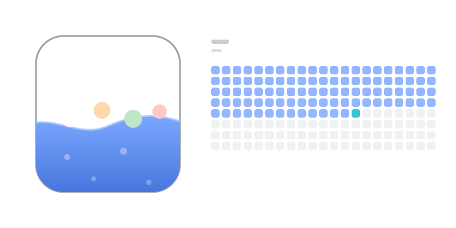

# TimeCup - 时间水杯

  
  
  
  

一个精致的 iOS 时间可视化 App，将时间流逝具象为杯中的流动水面。

## ✨ 功能

- **流动水杯**：高刷新率（90fps+）CADisplayLink 驱动的实时水面动画
- **物理模拟**：emoji 事件漂浮在水面上，支持拖拽、碰撞、重力感应
- **事件管理**：添加/编辑/删除时间事件（考试、比赛、纪念日等）
- **桌面小组件**：小/中/大三种尺寸，展示年度时间杯、事件进度
- **时间统计**：今日已过百分比、精确到秒的倒计时
- **搜索筛选**：按名称/emoji/备注搜索，按结束时间/开始时间/名称/进度排序
- **批量操作**：批量编辑模式，多选删除
- **震动反馈**：可配置的触觉反馈

## 🖼 长什么样

  

> 上图是按工程里的绘制逻辑做的示意图：水波形状、气泡位置、365 个小杯子的网格排布都取自代码里的参数（`FlowingWaterShape`、`BubbleLayer`、`TCYearCupCanvas`）。

## 🕒 桌面小组件的倒计时是怎么走秒的

WidgetKit 不会让你每秒刷一次小组件（一天只给 40–70 次刷新预算，两次之间至少间隔约 5 分钟），所以倒计时靠"刷"是刷不出来的。这里的做法是：

- 进行中的事件用 `Text(timerInterval: date...endDate, countsDown: true)`，**由系统自己每秒走字**，完全不占刷新预算；
- 时间线只在"画面真的会变"的时刻排 entry：**今天结束**（年度水杯翻页、今日圆环归零）和**每个事件的结束时刻**（进行中 → 已结束），最多 4 个，另有一个 6 小时兜底；
- 未开始 / 已结束是静态状态，直接用普通文字。

已知限制：桌面小组件里不显示秒（`Text(timerInterval:)` 在小组件中会自动降到"时分"粒度）。需要锁屏级的秒级倒计时，得走 Live Activity。

## 🛠 技术栈

- SwiftUI + Combine
- CADisplayLink 高刷新动画
- CoreMotion 重力感应
- WidgetKit 桌面小组件（Canvas 绘制年度水杯，`Text(timerInterval:)` 走秒）
- App Groups 数据共享
- 自研轻量 2D 物理引擎（碰撞检测、浮力模拟、流体阻力）

## ⚡️ 性能取舍

- **动画帧率自适应**：正常走 90fps（ProMotion），低电量模式降到 30fps —— 一杯水不该比导航更费电；
- **重力感应 30Hz + 阈值过滤**：变化小于 0.008 不发通知，手机平放时这条链路完全不触发 SwiftUI 重绘；
- **气泡用一张 Canvas 画完**：20 个气泡原来各是一个 SwiftUI 子视图，90fps 下每帧重新求值 + 布局；气泡不参与点击，进 Canvas 后视图树里只剩一个节点；
- **小组件刷新节流**：连续编辑时，1.2 秒内的多次存盘合并成一次 `reloadAllTimelines()`，不白烧 WidgetKit 的刷新预算。

## 📱 兼容性

- 工程部署目标：**iOS 26.4**（见 `project.pbxproj` 的 `IPHONEOS_DEPLOYMENT_TARGET`，Xcode 26 创建）
- 用到的版本门槛：`containerBackground(for: .widget)` 需要 iOS 17+，`Text(timerInterval:countsDown:)` 需要 iOS 16+

## 🔨 构建

1. 用 Xcode 26 打开 `timecup.xcodeproj`；
2. 两个 target（`timecup` 与 `TimeCupwidget`）都选自己的 Team；原工程用的是 `797M54YCK5`，不是自己的会签名失败；
3. 改 App Group：`group.com.liuhua.timecup` 在 `timecup/ContentView.swift` 与 `TimeCupwidget/TimeCupwidget.swift` 各出现一次，**两处必须一致**，否则小组件读不到事件；
4. 真机运行 → 回桌面长按 → 左上角「+」→ 搜 TimeCup 添加小组件。

## 👤 作者

刘斌

## 💚 支持

如果这个项目对你有帮助，欢迎请我喝杯咖啡～

  

## 📄 许可

课程设计作品